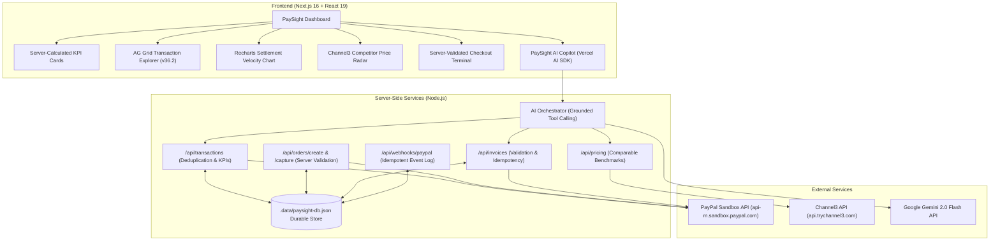

# ⚡ PaySight — AI-Powered PayPal Analytics & Market Intelligence

PaySight is an AI-powered merchant analytics and market intelligence dashboard built for PayPal business users. It bridges **PayPal payments**, **real-time market pricing via Channel3**, and **grounded conversational AI powered by Google Gemini 2.0 Flash**.

---

## 🎯 The Complete Merchant Journey

PaySight demonstrates an end-to-end operational journey for a digital merchant:

1. **Understand Payments & Analytics**: Inspect settlement velocity, gross volume, net volume, fees, refunds, and AOV using server-calculated figures with currency-aware totals.
2. **Compare Market Pricing**: Search or select a catalog item to cross-reference multi-retailer listings (Amazon, Best Buy, Walmart, B&H) using Channel3 to evaluate whether items are competitive or underpriced.
3. **Prepare an Invoice**: Formulate an invoice proposal via the UI or conversational Copilot, validating recipient email, line items, and quantities before any Sandbox submission.
4. **Exact Preview & Confirmation**: Review an exact preview of the proposed draft and explicitly authorize either a Sandbox Draft creation or immediate dispatch.
5. **Create in PayPal Sandbox**: Execute creation against PayPal Sandbox Invoicing API v2, receiving authoritative invoice identifiers and actual statuses.
6. **Live Terminal & Reconciliation**: Execute server-side captured orders with deduplication, webhook event tracking, and durable local persistence.

---

## 🏛️ System Architecture



---

## 🛠️ Technology Stack & Dependencies

- **Framework**: Next.js 16.4.2 (App Router, Turbopack) & React 19.3.0
- **Language**: TypeScript 5
- **Styling**: Tailwind CSS 4 with custom design tokens (pure white `#FFFFFF`, black sidebar `#111111`, monochrome logo, and restrained `#C2410C` orange accents)
- **Data Grids**: AG Grid Community 36.2.0 (`ag-grid-community`, `ag-grid-react`, Light Quartz theme)
- **Charts**: Recharts 3.10.1 (SVG AreaChart with linear gradient)
- **AI & LLM**: Google Gemini 2.0 Flash via `@ai-sdk/google` 4.0.99 and Vercel AI SDK (`ai` 4.3.19)
- **PayPal Server SDK**: `@paypal/paypal-server-sdk` 2.5.0 (TransactionSearchController, OrdersController)
- **PayPal Client SDK**: `@paypal/react-paypal-js` 10.6.0 (Official checkout button controls)
- **Market Intelligence**: Channel3 REST API v1 (`https://api.trychannel3.com/v1`)
- **Persistence**: File-backed atomic local database (`.data/paysight-db.json`) ensuring durability across reloads and zero lost transactions

---

## 🤝 Verified Sponsor Integrations

| Technology / Tool | Implementation Scope | Implementation Files |
|---|---|---|
| **PayPal Sandbox** | Server-side Orders v2 creation/capture, Invoicing v2 draft creation/sending, Transaction Search integration, and webhook event idempotency. | `src/lib/paypal/client.ts`, `src/lib/paypal/api.ts`, `src/app/api/orders/` |
| **AG Grid** | Renders transaction matrix and multi-retailer competitor price radar using the Light Quartz theme, column resizing, custom cell renderers, and CSV export. | `src/components/dashboard/TransactionGrid.tsx`, `src/components/dashboard/CompetitorPricingGrid.tsx` |
| **Channel3** | Live multi-retailer pricing radar with brand extraction, exact vs approximate match segregation, benchmark floor/ceiling/average calculation, and retailer links. | `src/lib/channel3/client.ts`, `src/app/api/pricing/route.ts` |
| **APIMatic** | APIMatic schema context definitions for PayPal Invoicing and Transaction Search parameters embedded into the assistant's structured system prompt to guide tool argument generation. | `src/lib/ai/orchestrator.ts` |
| **Render** | Blueprint configuration (`render.yaml`) defining web service build commands (`npm run build`) and production start commands (`npm run start`). | `render.yaml` |

> [!NOTE]
> **Developer Dashboard Note**: To use live Sandbox Transaction Search, verify that the **Transaction Search** feature is enabled in your PayPal Developer Dashboard app settings (`developer.paypal.com/dashboard/applications/sandbox`).

---

## 🚀 Getting Started

### 1. Prerequisites
- Node.js 18+ (verified on Node 20 / Node 24)
- npm 9+
- A [PayPal Developer Sandbox Account](https://developer.paypal.com) (optional for Demo Mode)
- A [Google AI Studio API Key](https://aistudio.google.com/app/apikey) (for Gemini Copilot)

### 2. Installation
```bash
git clone https://github.com/yugomania/ai-interface.git
cd ai-interface
npm install
```

### 3. Environment Modes

#### Option A: Zero-Configuration Demo Mode (Default)
PaySight runs immediately out-of-the-box without requiring live PayPal credentials. It uses persistent local storage (`.data/paysight-db.json`) seeded with deterministic merchant records:
```bash
cp .env.example .env.local
npm run dev
```

#### Option B: Live PayPal Sandbox Connection
Fill your credentials in `.env.local`:
```env
PAYPAL_CLIENT_ID=your_sandbox_client_id
PAYPAL_CLIENT_SECRET=your_sandbox_client_secret
PAYPAL_ENVIRONMENT=sandbox
NEXT_PUBLIC_PAYPAL_CLIENT_ID=your_sandbox_client_id
GOOGLE_GENERATIVE_AI_API_KEY=your_gemini_api_key
CHANNEL3_API_KEY=your_channel3_api_key
```

### 4. Running the Application
```bash
npm run dev
```
Open [http://localhost:3000](http://localhost:3000) in your browser.

---

## 🎬 3-Minute Demo Script (For Judges & Evaluators)

**Time: 2 minutes 45 seconds**

- **0:00 - 0:30 | The Merchant Problem & Overview**:
  - Open `http://localhost:3000`. Point out the clean white interface, solid black sidebar with monochrome "P" logo, and KPI cards showing net volume and settled orders.
  - Explain that merchants struggle to reconcile payments, compare competitor pricing, and generate invoices quickly without logging into multiple tools.

- **0:30 - 1:15 | Trustworthy Analytics & Grounded AI**:
  - Click on the **PaySight Copilot** prompt: *"Summarise my payments for the last 30 days."*
  - Watch the assistant call the server-side `summarizePayments` tool.
  - Notice the response explicitly identifies the reporting window (30 days), currency (USD), data source, gross volume, net volume, and fees—matching the exact numbers displayed in the KPI cards and Recharts velocity curve.

- **1:15 - 1:55 | Price Comparison (Channel3)**:
  - Navigate to the **Price comparison** tab.
  - View the live comparison grid. In the search bar at the top, enter a custom product: `Sony WH-1000XM5` with your price `$149.99`.
  - Click **Compare Item**. Watch the Channel3 client retrieve multi-retailer listings (Amazon, Best Buy, Walmart, B&H) and calculate the market floor ($149.00), ceiling ($179.95), and benchmark average ($162.98).
  - Click on the row to view the drilldown modal showing exact retailer source links and match classifications.

- **1:55 - 2:30 | Two-Step Invoicing Workflow**:
  - Click **+ New Invoice** in the top bar.
  - Step 1: Confirm customer `Acme Global Partners`, `finance@acmepartners.com`, and amount `$1,250.00`. Click **Review Preview**.
  - Step 2: Review the exact invoice preview with cryptographic confirmation token binding. Choose **Create as DRAFT**.
  - Step 3: Click **Confirm & Create Invoice**. The modal executes creation and returns the actual invoice identifier (`INV2-SANDBOX-...`) with status `DRAFT`.
  - Switch to the **Invoices** tab to see the newly created invoice immediately appear in the active invoice ledger.

- **2:30 - 2:45 | Sandbox Checkout & Reconciliation**:
  - Switch to the **Sandbox checkout** view (under Demo Tools).
  - Click **Execute Sandbox Checkout** on the Pro Merchant Plan ($49.00).
  - The payment is captured server-side with amount verification and added to the transactions ledger without double counting.

---

## 🧪 Automated Testing

Run the test suite covering analytics calculations, date chunking, invoice validation, idempotency, and webhook deduplication:
```bash
npm test
```

Run static analysis and production build:
```bash
npm run lint
npm run build
```

---

## 📜 License

Licensed under the [MIT License](LICENSE).
