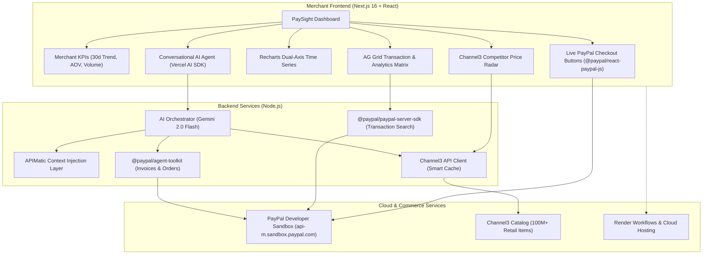

# ⚡ PaySight — AI-Powered PayPal Analytics & Shopping Intelligence

> Built for the **PayPal AI Hackathon 2026** ([paypalaihackathon.devpost.com](https://paypalaihackathon.devpost.com/))  
> Target Categories: **Best Overall**, **Most Impactful**, **Best Use of Agentic Commerce**, **AG Grid Bonus ($5K)**, **APIMatic Bonus ($1K)**, **Channel3 Bonus ($1.5K)**, **Render Bonus ($1K)**.

---

## 💡 Overview

**PaySight** is a next-generation merchant command center that bridges **PayPal payments**, **real-time market intelligence**, and **autonomous AI agents**. 

Merchants no longer have to manually reconcile spreadsheets or guess whether their product pricing is competitive. With PaySight, business owners can converse with an autonomous AI agent that has real-time context over their PayPal transactions, proactively scans 100M+ competitor prices across 25,000+ retailers via **Channel3**, displays performance grids powered by **AG Grid**, and directly executes agentic commerce actions (creating invoices, generating payment links, managing disputes) through the **PayPal Agent Toolkit**.

---

## 🏛️ System Architecture



---

## ✨ Key Features

1. **Autonomous Conversational Commerce**
   - Natural language interaction: *"Create an invoice for Acme Corp for $2,500"*, *"Show me all failed transactions this week"*, or *"How is my pricing positioned against Amazon and Walmart?"*
   - Powered by **Google Gemini 2.0 Flash** with structured function calling.

2. **High-Performance Data Grids (AG Grid)**
   - Sortable, filterable, pagination-enabled transaction explorer with status badges and currency formatting.
   - In-app CSV data export for accounting and reconciliation.
   - Competitor pricing matrix highlighting whether items are **Competitive**, **Overpriced**, or **Below Market**.

3. **Live Market Price Intelligence (Channel3)**
   - Cross-references merchant catalog items with 100M+ real-time retail product records.
   - Provides instant visibility into competitor pricing floor, ceiling, and average benchmarks.

4. **Interactive Sandbox Payment Simulator (@paypal/react-paypal-js)**
   - Judges can test interactive sandbox checkouts directly within the dashboard.
   - Successful captures immediately reflect in the AG Grid transaction ledger and update revenue KPIs in real time.

---

## 🤝 Sponsor Tooling & Integrations

| Sponsor Tool | Implementation Details | Hackathon Track |
|---|---|---|
| **PayPal SDKs** | Uses `@paypal/paypal-server-sdk` (Transaction Search), `@paypal/agent-toolkit/ai-sdk` (autonomous tool-calling), `@paypal/react-paypal-js` (interactive checkout buttons), and PayPal Invoicing v2 REST API. | Primary Requirement & Agentic Commerce |
| **AG Grid** | Renders both the live transaction ledger and the multi-merchant price comparison grid with custom quartz-dark theme styling, sorting, and CSV export. | Best Use of AG Grid ($5,000) |
| **APIMatic** | System prompt embeds APIMatic's Context Plugin structure for PayPal API endpoints, eliminating model hallucinations on payload schemas. | Best Use of APIMatic ($1,000) |
| **Channel3** | Integrated in `/api/pricing` and AI orchestrator tools to fetch live multi-retailer pricing data with aggressive caching to maximize query quotas. | Best Use of Channel3 ($1,500) |
| **Render** | Pre-configured `render.yaml` blueprint for one-click deployment with zero-configuration environment variables. | Best Use of Render ($1,000 credits) |

---

## 🚀 Getting Started

### 1. Prerequisites
- Node.js 18+ and npm
- A [PayPal Developer Account](https://developer.paypal.com) (Sandbox credentials)
- A [Google AI Studio API Key](https://aistudio.google.com/app/apikey) (Free tier)
- Optional: [Channel3 API Key](https://trychannel3.com/)

### 2. Installation
```bash
# Clone the repository
git clone https://github.com/yugomania/ai-interface.git
cd ai-interface

# Install dependencies
npm install
```

### 3. Environment Setup
Create a `.env.local` file using the provided `.env.example`:
```bash
cp .env.example .env.local
```

Fill in your sandbox credentials:
```env
PAYPAL_CLIENT_ID=your_sandbox_client_id
PAYPAL_CLIENT_SECRET=your_sandbox_client_secret
PAYPAL_ENVIRONMENT=sandbox
NEXT_PUBLIC_PAYPAL_CLIENT_ID=your_sandbox_client_id
GOOGLE_GENERATIVE_AI_API_KEY=your_gemini_api_key
CHANNEL3_API_KEY=your_channel3_api_key
```

### 4. Run Locally
```bash
npm run dev
```
Open [http://localhost:3000](http://localhost:3000) in your browser.

---

## 🧪 Testing Prompts for Judges

Try asking the **PaySight AI** assistant:
1. *"What is my revenue summary for the last 30 days?"*
2. *"Show me all failed or pending transactions."*
3. *"Create a PayPal invoice for Acme Corp for $1,250 for website consulting services."*
4. *"How does my price of $149.99 for Premium Headphones compare to market competitors?"*
5. *"Are there any open disputes I need to review?"*

---

## ☁️ Deployment (Render)

PaySight includes a production-ready `render.yaml`:
1. Push this repository to GitHub.
2. Log into [Render Dashboard](https://dashboard.render.com).
3. Click **New +** → **Blueprint**.
4. Select your repository. Render will automatically detect `render.yaml`, build the Next.js app, and deploy it to a global CDN.

---

## 📜 License

This project is licensed under the MIT License — see the [LICENSE](LICENSE) file for details.
